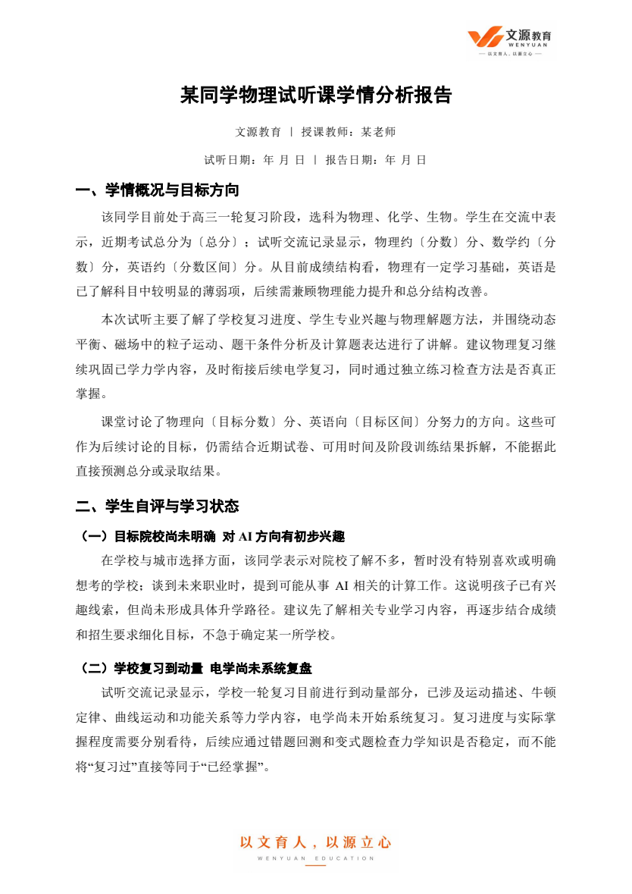
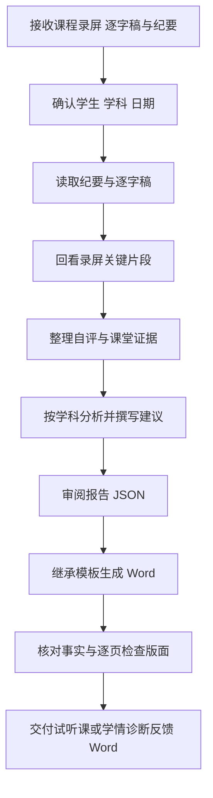

# 试听课反馈与学情诊断 · Trial Feedback Studio

> 根据一次课程的**录屏、逐字稿和纪要**，整理成一份 Word 版**试听课反馈报告或学情诊断反馈报告**。

**项目名：** `trial-feedback-studio`　|　**作者：** [Yujie Chen](https://github.com/Yu-Jie-Chen)　|　**仓库：** [Yu-Jie-Chen/trial-feedback-studio](https://github.com/Yu-Jie-Chen/trial-feedback-studio)


## 它是做什么的

这是一个面向老师的课程反馈整理技能。提供课程录屏，以及对应的逐字稿和纪要，Agent 将结合课堂内容、学生自述与实际作答表现，分析学习情况，整理后续建议，最终生成可编辑的 Word 报告。

它适用于两类场景：

| 场景 | 报告重点 | 交付形式 |
|---|---|---|
| 试听课反馈 | 本次试听内容、学生表现、学习困难和后续教学建议 | Word 试听课反馈报告 |
| 学情诊断反馈 | 学生当前基础、具体卡点、学习习惯及改进方向 | Word 学情诊断反馈报告 |

两类报告都围绕同一条流程：**课程资料 → 学情分析 → 反馈建议 → Word 文档**。报告不是简单复制会议纪要，而是把课程中与学生学习有关的信息整理成家长和老师能直接使用的反馈。

## 它解决什么问题

试听课或学情诊断课结束后，老师往往还要花时间整理一份家长能看懂的反馈：

- 学生成绩、复习进度和个人目标散落在课堂对话里；
- 会议纪要能概括内容，却不一定区分学生自评与教师判断；
- 自动转写可能把姓名、公式、学科术语识别错；
- “课堂讲过”容易被写成“学生已经掌握”；
- 换一个学生或学科，又要重新调整字体、段落和公司 Logo。

**Trial Feedback Studio** 将资料核对、学科分析与固定版式结合起来，让老师把时间用在判断和反馈上。

```text
课程录屏 + 对应逐字稿 + 纪要（通过回顾链接或本地文件提供）
                ↓
确认学生、学科、课程日期和资料范围
                ↓
提取学生自评 + 核对课堂问答与关键画面
                ↓
形成学情判断与针对性建议
                ↓
按参考模板生成 Word 试听课反馈 / 学情诊断反馈报告
                ↓
核对事实 + 检查每页版面 → 教师复核后使用
```

这是一个由 Agent 执行的 **Skill**。浏览器访问、视频理解与内容分析依赖宿主提供的能力；仓库中的 Python 脚本负责将已审阅的文字排成 Word，不是输入网址就能独立完成转写与诊断的程序。

## 核心特点

### 1. 学生自己的感受，单独写清楚

报告保留“学生自评与学习状态”部分：孩子觉得哪里困难、如何复习、怎样看待自己的成绩、对未来有什么想法。只采用本次资料中实际表达的内容，未谈到的睡眠、家庭关系和学习习惯不补写。

### 2. 课堂反馈有具体依据

围绕具体题目与问答整理：

**做了什么任务 → 学生如何回答 → 教师怎样引导 → 能支持什么判断 → 下一步怎样检查。**

教师讲过一个方法，不代表学生已掌握；回答“懂了”，也不等于能独立完成变式题。资料只有纪要时，反馈的确定程度也应相应收敛。

### 3. 三科学情分别分析

| 学科 | 主要关注 | 反馈中的关键区别 |
|---|---|---|
| 物理 | 概念条件、研究对象、受力与运动、模型、实验、计算表达 | 会背公式与会判断适用条件；听懂例题与独立建模 |
| 数学 | 定义条件、运算、图像与几何、分类讨论、推理、方法选择 | 思路不会与计算出错；提示后完成与独立完成 |
| 英语 | 词汇语境、句法、阅读证据、听力、写作、时间安排 | 词不认识、句子没读懂与定位错误；未测项目不作判断 |

具体诊断依据本次课程与学生年级调整，不固定套用高三物理的问题清单。详细规则见 [学科诊断与文风](references/writing.md)。

### 4. 版式由真实模板继承

生成器读取保留的参考 Word，继承样式和段落直接格式，而不是每次临时设计。

| 位置 | 默认格式 |
|---|---|
| 文档标题 | 黑体，18磅，居中 |
| 一级标题 | 黑体，14磅 |
| 二级标题 | 黑体，12磅 |
| 正文 | 宋体，12磅；缩进、行距与段落格式沿用参考 |
| 英文与数字 | Times New Roman |
| 页眉 | 文源教育 Logo，右上角 |
| 页脚 | 品牌理念图，底部居中 |
| 栏目样式 | 无浅橙色底色，不另加装饰封面 |

实际版式以 [`assets/reference.docx`](assets/reference.docx) 为准。报告日期与试听日期分开填写；缺少授课教师信息时省略该字段，不沿用旧报告中的教师姓名。

### 5. 建议对应问题，目标不写成承诺

学习建议需要说明练什么、怎么练、如何检查。复习进度不换算成掌握百分比，目标分数不写成保证提分。默认不加入固定四周计划；用户要求或课堂已有明确安排时，再按实际内容扩展。

### 6. 读取范围和检查结果如实交代

纪要用于梳理结构，逐字稿用于核对原话，录屏用于检查题图、板书和实际互动。遇到页面超时先尝试复用标签页、导出或其他可用读取方式；关键资料仍不可用时，明确说明缺少什么。

成品需要检查每页版面。没有视频访问能力，不声称看过视频；没有完成视觉检查，也不声称排版已验证。

## 成品预览

以下为去标识化示例报告首页，姓名、教师、日期与成绩使用示例称谓或占位符：



- [查看参考 Word 报告](assets/reference.docx)
- [查看技能入口](SKILL.md)
- [查看报告数据结构](references/schema.md)

参考报告用于复现结构、字体和表达方式。生成新学生报告时，不能继承参考学生的成绩、专业兴趣、知识薄弱点或课堂表现。

## 报告包含哪些内容

默认按当前参考文档的六部分组织，通常为3—5页，具体长度取决于资料，不凑字数。

| 部分 | 家长能了解到什么 |
|---|---|
| 一、学情概况与目标方向 | 已核实的成绩、复习阶段、课程重点及目标 |
| 二、学生自评与学习状态 | 孩子自己表达的困难、习惯与想法 |
| 三、本次试听内容与课堂反馈 | 本次实际讲了什么，孩子如何参与和作答 |
| 四、主要问题与后续改进重点 | 当前最需要解决的问题及判断依据 |
| 五、日常执行与家长配合建议 | 日常怎么落实，家长可以怎样支持 |
| 六、总结 | 当前基础与下一阶段的主要方向 |

最终交付为可编辑的 `.docx` 文档。试听课场景使用“试听课反馈报告”，诊断课场景使用“学情诊断反馈报告”，标题与文件名应匹配本次用途。脚本按 `report_type` 自动匹配标题、文件名与文档标题属性：`trial` 为试听课反馈，`diagnostic` 为学情诊断反馈，默认 `trial`。证据笔记、JSON 和版面检查文件属于工作过程，除非用户需要，不作为最终交付物。

## 快速开始

### 方式一：交给 Agent 安装和调用

把仓库链接发给支持技能安装的 Agent：

```text
请将这个仓库作为 Skill 安装，保留整个目录与模板资源：
https://github.com/Yu-Jie-Chen/trial-feedback-studio
```

也可以先克隆：

```bash
git clone https://github.com/Yu-Jie-Chen/trial-feedback-studio.git
```

将完整文件夹放到宿主配置的技能目录，入口为 [`SKILL.md`](SKILL.md)。**不要只复制 SKILL.md**：生成报告还需要 `assets/`、`scripts/` 和 `references/`。

DeepSeek Agent 的具体技能目录和加载方式以实际宿主配置为准。本项目是技能文件夹，没有 npm 插件包配置；应按宿主的 Skill 加载方式使用。

安装后可以直接说：

```text
使用 trial-feedback-studio，给我按照这个录屏生成试听课反馈报告。

回顾：某同学物理试听
日期：YYYY-MM-DD HH:mm:ss
回顾文件：在这里粘贴腾讯会议回顾链接
```

支持自动技能选择的宿主，也可直接使用“给我按照这个录屏生成试听课反馈报告”。

### 学情诊断反馈示例

```text
这是一次学情诊断课的录屏、逐字稿和纪要。
请结合学生自评、课堂作答和老师的分析，整理一份 Word 学情诊断反馈报告。
沿用文源教育的字体、段落和 Logo 版式。
回顾文件：在这里粘贴链接
```

### 其他调用示例

**数学试听：**

```text
根据这个数学试听回顾生成 Word 反馈报告。
重点写学生自评、课堂解题卡点和后续训练建议，沿用文源教育版式。
回顾文件：在这里粘贴链接
```

**英语试听：**

```text
根据这次英语试听的录屏、逐字稿和纪要生成反馈报告。
区分词汇、句子理解和阅读方法的问题，没有测试的项目不要作结论。
回顾文件：在这里粘贴链接
```

**已有本地资料：**

```text
这是课程录屏及对应逐字稿和纪要，请生成试听课反馈或学情诊断反馈 Word 报告。
学生姓名：填写姓名；科目：填写科目；试听日期：填写日期。
```

### 方式二：只用 Word 排版脚本

如果已经完成资料分析和报告撰写，可以直接把文字填入 JSON，再生成 Word。

```bash
cd trial-feedback-studio
python -m pip install -r requirements.txt
python scripts/build_report.py --input report.json --output-dir output
# 覆盖 JSON 中的类型，生成诊断报告
python scripts/build_report.py --input report.json --report-type diagnostic --output-dir output
```

`report.json` 需要自行准备，格式见 [数据结构示例](references/schema.md)。主要字段如下：

| 字段 | 用途 |
|---|---|
| `student` | 学生姓名 |
| `subject` | `物理`、`数学`或`英语` |
| `report_type` | `trial` 或 `diagnostic`，默认 `trial` |
| `teacher` | 授课教师，可省略 |
| `lesson_date` | 试听日期，格式 `YYYY-MM-DD` |
| `report_date` | 报告日期，格式 `YYYY-MM-DD` |
| `sections` | 各节标题与正文块；正文块支持段落和二级标题 |

可通过 `--template /路径/参考.docx` 指定另一份模板，需含 `Title`、`Subtitle`、`Heading 1`、`Heading 2` 和 `Normal` 样式的非空示例段落。输出文件已存在时脚本会拒绝覆盖，请使用新文件名。

脚本会检查必要字段、日期和段落结构，但**不会验证成绩、课堂表现或学科结论是否真实**，这些仍需 Agent 和老师依据课程资料核对。

## 运行环境

| 能力 | 是否需要 | 说明 |
|---|---|---|
| 能加载 Skill 的 Agent | 完整流程需要 | 负责资料读取、分析和撰写 |
| 浏览器或资料连接器 | 读取会议链接需要 | 需要有对应会议的访问权限 |
| 视频理解或转写能力 | 处理录屏需要 | 由宿主提供，本仓库不内置转写服务 |
| Python 3 + python-docx | 生成 Word 需要 | 依赖列于 `requirements.txt` |
| 宋体、黑体、Times New Roman | 保持参考字体需要 | 缺少字体时可能发生替换 |
| Word、允许使用的 LibreOffice 或宿主渲染器 | 版面检查需要 | 导出检查版并逐页查看 |

普通聊天窗口仅上传技能文件，不一定能执行浏览器访问和本地脚本。项目不附带腾讯会议登录凭据，也不自动安装浏览器或 Office。

## 工作流与质量检查



交付前重点检查：

1. 学生姓名、学科、试听日期与报告日期正确，未残留旧学生信息。
2. 学生自评、教师讲解、课堂观察和建议没有混为一谈。
3. 分数、目标与薄弱点有依据，公式和学科术语经过核对。
4. 建议与具体问题对应，没有无依据的提分承诺。
5. 标题、正文、Logo 和页脚正常，无截断、空白页或标题孤行。
6. 实际读取范围、视频访问情况和视觉检查状态表述准确。

详细规则见 [资料读取与证据规则](references/evidence.md)。

## 仓库结构

```text
trial-feedback-studio/
├── SKILL.md                    # Agent 技能入口与执行规则
├── README.md                   # 项目介绍与快速开始
├── 使用说明.md                 # 简短安装调用说明
├── requirements.txt            # Word 生成依赖
├── agents/
│   └── openai.yaml             # 支持该配置的宿主所用展示信息
├── assets/
│   ├── reference.docx          # 格式与文风参考，含品牌图片
│   └── preview.png             # 参考报告首页预览
├── references/
│   ├── evidence.md             # 资料读取、故障恢复与证据核对
│   ├── writing.md              # 三科诊断与写作要求
│   └── schema.md               # JSON 结构和运行说明
└── scripts/
    └── build_report.py         # 将已审阅正文排成 Word
```

## 常见问题

**录屏、逐字稿和纪要都在同一个回顾链接中，可以使用吗？**

可以，回顾链接是课程资料的入口，Agent 会尝试读取其中的录屏、逐字稿和纪要。能否直接读取取决于宿主浏览器能力和会议分享权限。遇到登录或权限限制，需要完成正常授权或提供导出的逐字稿、纪要。

**会自动看完整个录屏吗？**

技能要求结合逐字稿回看关键片段，重点检查学生作答、教师提示、题图和板书；不承诺每次都完整观看。Agent 应如实说明实际使用了哪些资料。

**能否只用纪要生成？**

完整流程以录屏、逐字稿和纪要为依据。若暂时只有纪要，可以先整理有限的文字反馈，但不能将其描述为已完成录屏分析；需要课堂表现诊断时，应补充原始资料。仅有摘要无法证明孩子独立完成了题目。

**为什么没有自动加四周提分计划？**

当前确认的模板采用六部分结构，默认将建议写入改进重点和日常执行。需要阶段计划时，在请求中说明即可。

**可以换成自己机构的 Logo 吗？**

可以准备包含目标页眉、页脚和样式示例的参考 Word，通过 `--template` 指定；若要长期作为技能默认版式，再更新模板及相关说明。修改后重新检查每页效果。

**可以直接发给家长吗？**

生成的是可编辑的 Word 报告，建议老师核对姓名、分数、课堂结论与实际教学安排后再发送。技能不会自动向家长或群聊发布。

## 参考资料与使用范围

仓库保留了去标识化示例报告和品牌资产，用于重现版式与文风。公开可访问不代表其中的学生案例可以作为其他学生的事实，也不代表品牌素材获得了通用授权。提交新示例时请使用虚构或已授权、去标识化的内容。

本仓库目前未附通用开源许可证；代码与素材的使用授权请与所有者确认。

## 相关项目

[错题整理 · Mistake Question Studio](https://github.com/Yu-Jie-Chen/mistake-question-studio)：用于整理错题、解析与复习卡。本项目侧重试听课与学情诊断反馈，错题整理侧重具体题目的复习材料；两者可由老师按需要配合使用，目前没有自动联动接口。

## English summary

**Trial Feedback Studio** is an agent skill for creating Chinese trial-lesson feedback and learning-diagnostic feedback reports in Word for physics, mathematics, and English. It guides the agent through reviewing meeting notes, transcripts, and relevant recording segments, distinguishing student self-assessment from observed performance, and drafting practical learning recommendations.

The Python builder formats reviewed content using a retained Word reference, including typography, a top-right brand logo, and a centered footer graphic. Meeting access and video analysis depend on the host agent; they are not implemented by the builder. Start with [`SKILL.md`](SKILL.md).

两种报告共用同一模板、正文结构、字体和 Logo，仅报告标题与自动文件名随提示词切换；日期栏统一使用“课程日期”。

## 自动归档到文源教学工作台

成品检查通过后，Agent 可以直接归档到对应学生，无需再手动选择文件上传。支持本地工作台源码版及含统一接口的安装版：反馈进入学生专属资料，试卷分析进入学情诊断库，错题进入学生错题本与待审题库。诊断反馈还可关联对应试卷分析。

一次配置本机连接后，Skill 会完成学生匹配、提交和回执检查。学生重名时需指定 ID；工作台没启动时先保留文件和待归档清单，之后原样重试不会重复入库。新题目/诊断不会自动发布。

具体配置、命令和失败重试见 [工作台自动归档](references/workbench-archive.md)。客户端只依赖 Python 标准库，学生文件、归档清单、回执和令牌不上传 GitHub。
